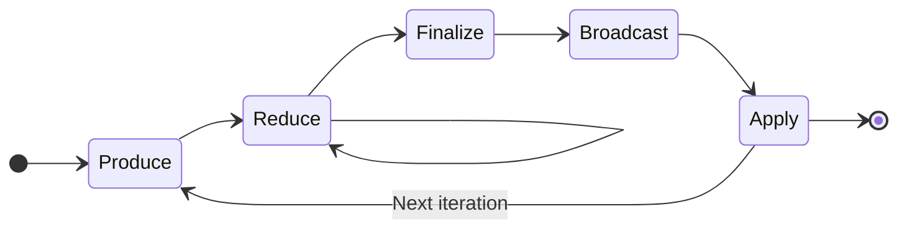
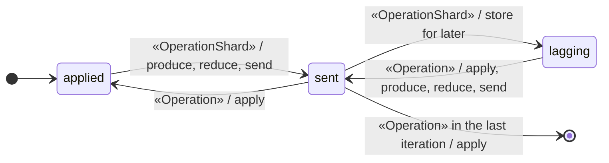
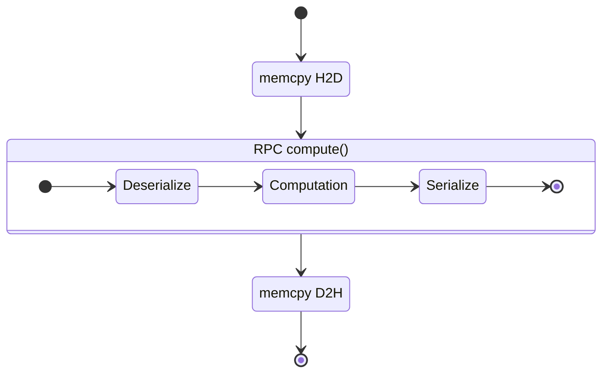

# Reduce-Broadcast-Apply (RBA)

A framework for a specific type of parallel computation on the Cerebras Wafer-Scale Engine (WSE), written in CSL.

It runs multiple independent *Tasks*. Each *Task* consists of one or more iterations, and each iteration performs
*produce*, *reduce*, *finalize*, *broadcast* and *apply* steps across the PE grid. You supply the problem-specific
functions and data structures; the framework supplies the layout, routing, message ordering and host-side plumbing.

Status: tested on the SDK 2.10.0 simulator only, for both the WSE-2 and WSE-3 targets; not run on real hardware. The design may change.

## Repository layout

* `rba/` – the framework (CSL): `rba.csl` (layout and routing), `kernel.csl`, `reducer.csl`, `principal.csl`, `router.csl`, `utils.csl`.
* `python/rba_runner.py` – host-side helper over the SDK's `SdkRuntime`.
* `examples/isosurface/` – a small example problem, also used as an integration test. See its README.

## Flow

The flow of a single *Task*:



* **Produce**: every *Kernel* PE produces an `OperationShard` from its local state.
* **Reduce**: `OperationShard`s are combined pairwise on the way across the grid.
* **Finalize**: the single remaining `OperationShard` is turned into an `Operation` using the global state.
* **Broadcast**: the `Operation` is sent back to all *Kernels*.
* **Apply**: every *Kernel* updates its local state using the `Operation`.

## Implementation

### PE types

* *Kernel* – the actual processing; holds shards of data, takes part in `produce`, `reduce` and `apply`.
* *Reducer* – only `reduce`.
* *Principal* – `finalize`; also holds the global state for the *Tasks*.
* *Router* – message routing only.

### Layout

```
KKK⋯Kr
KKK⋯KR
⋮⋮⋮⋱⋮⋮
KKK⋯KR
rrr⋯rP
```

`K` is a rectangle of *Kernels*, `R` are *Reducers*, `P` is the *Principal*, `r` are routers.
The rectangle of *Kernels* is described as a grid of `patch_count_h × patch_count_v` *patches*, each
`patch_size_h × patch_size_v` PEs. In the current implementation a patch is only a way of describing the grid:
every PE in a patch behaves independently, so the result is the same as a plain grid of the same total size.
Any PEs of the target rectangle outside the used area are filled with routers.

### Routing

1. `OperationShard`s are sent from west to east between *Kernels*, reaching the *Reducers* on the east edge.
2. Then `OperationShard`s are sent from north to south between *Reducers*, reaching the *Principal* in the south-east corner.
3. `Operation`s are sent simultaneously to all south routers (from east to west). Each of them sends a copy of the message north, and it propagates all the way to the north edge, where all *Kernels* receive it.

### Messages

The key invariant is ordering. On each edge between PEs, messages concern consecutive *Tasks* in increasing order.
With multiple iterations, after the last *Task* of iteration *i* comes the first *Task* of iteration *i+1*.

If a PE expects more than one incoming stream, the streams are not synchronized with each other and may precede
each other arbitrarily, though never by more messages than the number of *Tasks*. They are handled asynchronously
to avoid congestion; the order of handling is up to the PE's local task scheduler.

#### Kernel

There are two cases:

* westmost – produces and emits a sequence of `OperationShard`s,
* non-westmost – receives a sequence of `OperationShard`s and, in response to each, reduces it with its own
  freshly produced one and emits the result.

In both cases a *Kernel* also receives a sequence of `Operation`s. If the number of iterations is greater than one,
an `OperationShard` of the current iteration and an `Operation` of the previous iteration for the same *Task* have no
guaranteed relative order. A *Kernel* must wait for the `Operation` before taking part in the next reduction.

##### Westmost

In multi-iteration runs the westmost *Kernel* distinguishes two phases – whether the ordering of *Tasks* has been established in all PEs.

1. First, it emits the initial `OperationShard` for each *Task*. It must not respond to incoming `Operation`s before all `OperationShard`s of the first iteration have been emitted.
2. It clears the queue of incoming `Operation`s that did not yet result in an `OperationShard` by emitting them in order (FIFO). New `Operation`s may be appended to the queue during this phase.
3. The order is now established.
4. Each incoming `Operation` is immediately answered with an `OperationShard`.
5. On the last iteration, no `OperationShard`s are sent.

##### Non-westmost

The behaviour of the other *Kernels* is a per-*Task* state machine. Transitions depend on which message comes first
and are labelled *incoming message / action*.



#### Reducer

Expects two sequences of `OperationShard`s coming from two directions. It stores the first incoming message for a
*Task*; when the matching one arrives from the other direction, it reduces them and outputs the result.
That keeps the output ordered by *Task* number.

#### Principal

Expects `OperationShard`s in order and outputs the corresponding `Operation`s.

## What you implement

You provide a CSL module (passed as `ops_file`, with `ops_params`) defining the following.

### Structures

* `TaskLocalState` – data specific to a *Task*, stored in each *Kernel*.
* `SharedLocalState` – data shared by all *Tasks*, stored in each *Kernel*.
* `TaskGlobalState` – data specific to a *Task*, stored in the *Principal*.
* `SharedGlobalState` – data shared by all *Tasks*, stored in the *Principal*.
* `OperationShard` – data used in negotiating the *Operation*; combined by `reduce` across all *Kernels*.
* `Operation` – the negotiated action broadcast to all *Kernels*.

Each structure comes with a `*_SERIALIZED_SIZE` constant (in `f32` words) and serialization functions,
because CSL has no way to send a struct's memory as-is between PEs and host.

### Functions

* `produce(shard: *OperationShard, t: *TaskLocalState, s: *const SharedLocalState) void` – in *Kernel*.
* `reduce(result: *OperationShard, x: *const OperationShard, y: *const OperationShard) void` – in *Kernel* and *Reducer*.
* `finalize(op: *Operation, x: *const OperationShard, t: *TaskGlobalState, s: *const SharedGlobalState) void` – in *Principal*.
* `apply(op: *const Operation, t: *TaskLocalState, s: *const SharedLocalState) void` – in *Kernel*.

`examples/isosurface/rba_ops.csl` is a complete, small implementation.

### Serialization functions

*Copy mode*:

```
structure_name_deserialize(ret: *StructureName, source: [*]const f32, offset: u32) void
structure_name_serialize(target: [*]f32, offset: u32, source: *const StructureName) void
```

The reader deserializes from `source[offset]` to `source[offset + STRUCTURE_NAME_SERIALIZED_SIZE]`.

*Streaming mode* (used for `SharedLocalState`):

```
structure_name_from_stream(target: *SharedLocalState, first: f32, comptime stream: fabin_dsd) void
```

The function treats `first` as the first incoming float and reads the remaining ones from `stream`, a fabric input DSD
of extent 1 supplied by the framework (the way such a DSD is built differs between WSE-2 and WSE-3), e.g.

```
var f: f32;
@fmovs(&f, stream);
```

## Running

Data moves between host and device with the SDK's `memcpy` library, and `compute()` is launched through it as an RPC.



*Computation* is the flow described above, run for all *Tasks* and the requested number of iterations.
`compute(num_iterations)` can be called more than once, and the state can be read or updated between calls.

### Memory

Exported symbols:

* each *Kernel*: `task_state` – serialized `TaskLocalState`s (copy mode),
* the *Principal*: `task_state` – serialized `TaskGlobalState`s, and `shared_state` – serialized `SharedGlobalState` (copy mode).

`SharedLocalState` is streamed to the *Kernels* (host-to-device stream whose color is the `MEMCPYH2D_DATA_1_ID`
compile parameter) and deserialized on the fly.

Before `compute`, all of these must be populated; deserialization happens on the PEs at the start of `compute`.
After the computation the `task_state`s are serialized back and can be read with `memcpy_d2h`. `shared_state` is
read-only. Copy mode roughly doubles memory use for the affected data, since the serialized copy stays resident.

## Building and running the example

Requirements: the Cerebras SDK (tested with 2.10.0), obtained from Cerebras under its own license terms; this repository does not contain any part of it. `cslc` and `cs_python` are the SDK's wrappers.

```
export CSLC=/path/to/sdk/cslc
examples/isosurface/build.sh            # or: build.sh PAD_X PAD_Y for extra PEs around the used rectangle
RBA_VARIANT=iso /path/to/sdk/cs_python examples/isosurface/run.py

ARCH=wse3 examples/isosurface/build.sh  # the same for the WSE-3 target
RBA_VARIANT=iso_wse3 /path/to/sdk/cs_python examples/isosurface/run.py
```

`python/rba_runner.py` is a thin layer over the SDK's `SdkRuntime`. Only one simulation fits in a process, so run one
variant (`iso`, `iso_pad2x0`, `iso_wse3`, ...) per invocation.

Notes for SDK 2.x:

* The framework uses input queues 2 to 4 and output queue 2; queues 0 and 1 belong to the SDK's `memcpy` library.
* Differences between the targets are handled with `@is_arch`: on WSE-3 data tasks are bound to input queues rather
  than colors, and the color of an output queue is set when the queue is initialized rather than in the DSD.
* `ops_params` and `memcpy_params` are untyped `param`s.
* Tensors passed to `memcpy_h2d`/`memcpy_d2h` must be one-dimensional.

## Acknowledgements

This work was carried out in the project *ASICs* (POIR.01.01.01-00-2340/20, "Opracowanie i implementacja efektywnych,
inspirowanych komputerami kwantowymi, metod wykonywania złożonych obliczeń na klasycznych (nie-kwantowych), sprzętowych
wyżarzaczach zbudowanych na specjalizowanych układach scalonych (ASICs)"), implemented by BEIT Sp. z o.o. and
co-financed by the European Regional Development Fund under the Smart Growth Operational Programme 2014-2020,
Sub-measure 1.1.1, with the support of the National Centre for Research and Development (Narodowe Centrum Badań
i Rozwoju, NCBR), Poland.

## License

Apache License 2.0; see `LICENSE` and `NOTICE`.

Cerebras, Wafer-Scale Engine, WSE and CSL are trademarks or product names of Cerebras Systems Inc., used here only to
identify the platform this code targets. This is an independent project, not an official Cerebras product.
